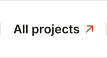
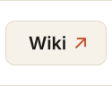
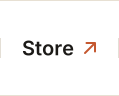

<a href="https://lusansapkota.com.np"><picture><source media="(prefers-color-scheme: dark)" srcset="assets/hero-card-dark.svg"></picture></a>
 
<picture><source media="(prefers-color-scheme: dark)" srcset="assets/hero-card-foot-pad-dark.svg"></picture><a href="https://lusansapkota.com.np"><picture><source media="(prefers-color-scheme: dark)" srcset="assets/hero-card-foot-portfolio-dark.svg"></picture></a><a href="https://git.lusansapkota.com.np"><picture><source media="(prefers-color-scheme: dark)" srcset="assets/hero-card-foot-projects-dark.svg"></picture></a><a href="https://wiki.lusansapkota.com.np"><picture><source media="(prefers-color-scheme: dark)" srcset="assets/hero-card-foot-wiki-dark.svg"></picture></a><a href="https://store.lusansapkota.com.np"><picture><source media="(prefers-color-scheme: dark)" srcset="assets/hero-card-foot-store-dark.svg"></picture></a><a href="mailto:contact@lusansapkota.com.np"><picture><source media="(prefers-color-scheme: dark)" srcset="assets/hero-card-foot-email-dark.svg"></picture></a><picture><source media="(prefers-color-scheme: dark)" srcset="assets/hero-card-foot-fill-dark.svg"></picture>
