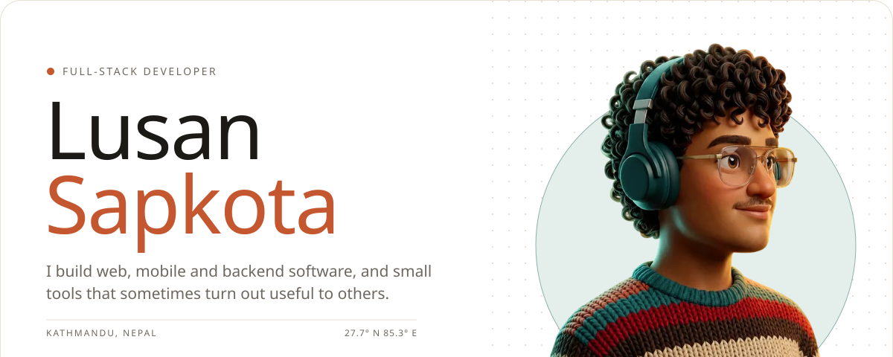

<a href="https://lusansapkota.com.np">
  <picture>
    <source media="(prefers-color-scheme: dark)" srcset="assets/hero-dark.svg">
    
  </picture>
</a>
 
<a href="https://lusansapkota.com.np"><picture><source media="(prefers-color-scheme: dark)" srcset="assets/link-portfolio-dark.svg"></picture></a>
<a href="https://git.lusansapkota.com.np"><picture><source media="(prefers-color-scheme: dark)" srcset="assets/link-projects-dark.svg"></picture></a>
<a href="https://wiki.lusansapkota.com.np"><picture><source media="(prefers-color-scheme: dark)" srcset="assets/link-wiki-dark.svg"></picture></a>
<a href="https://store.lusansapkota.com.np"><picture><source media="(prefers-color-scheme: dark)" srcset="assets/link-store-dark.svg"></picture></a>
<a href="mailto:contact@lusansapkota.com.np"><picture><source media="(prefers-color-scheme: dark)" srcset="assets/link-email-dark.svg"></picture></a>
