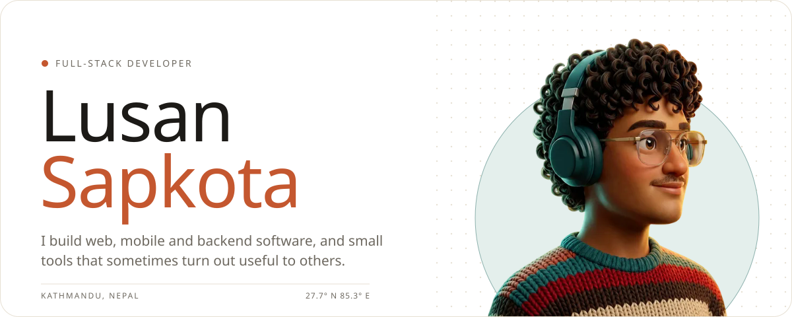
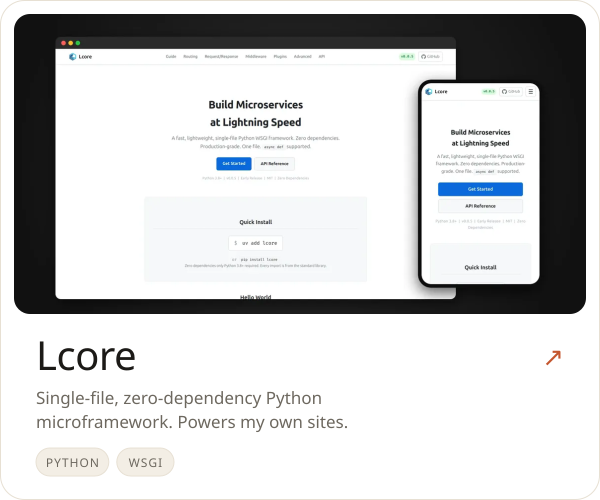
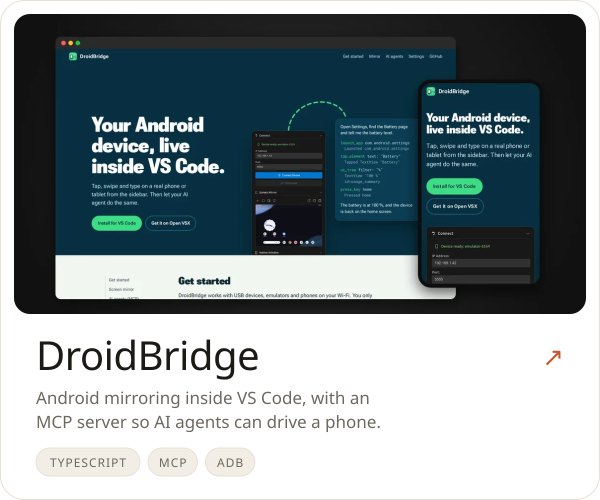
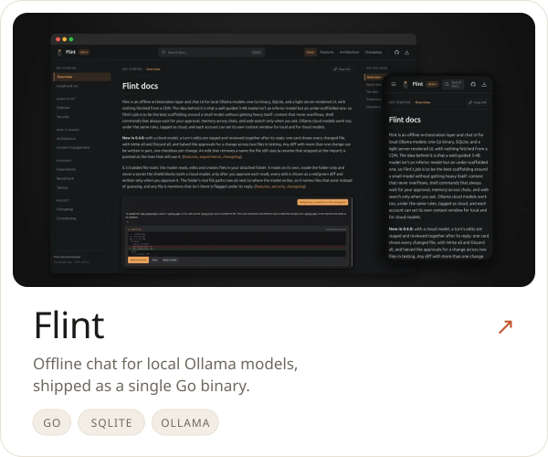
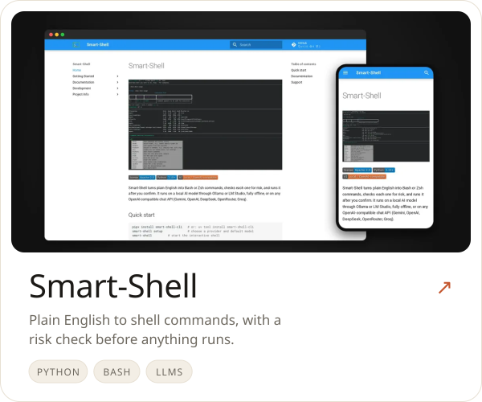
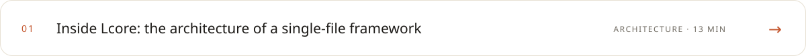
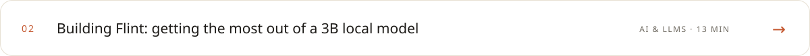
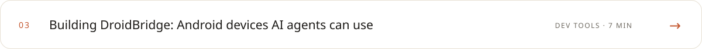
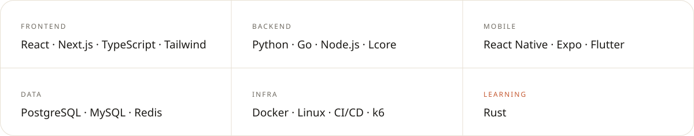

<a href="https://lusansapkota.com.np">
  <picture>
    <source media="(prefers-color-scheme: dark)" srcset="assets/hero-dark.svg">
    
  </picture>
</a>

  <a href="https://lusansapkota.com.np"><picture><source media="(prefers-color-scheme: dark)" srcset="assets/link-portfolio-dark.svg"></picture></a>
  <a href="https://git.lusansapkota.com.np"><picture><source media="(prefers-color-scheme: dark)" srcset="assets/link-projects-dark.svg"></picture></a>
  <a href="https://wiki.lusansapkota.com.np"><picture><source media="(prefers-color-scheme: dark)" srcset="assets/link-wiki-dark.svg"></picture></a>
  <a href="https://store.lusansapkota.com.np"><picture><source media="(prefers-color-scheme: dark)" srcset="assets/link-store-dark.svg"></picture></a>
  <a href="mailto:contact@lusansapkota.com.np"><picture><source media="(prefers-color-scheme: dark)" srcset="assets/link-email-dark.svg"></picture></a>

 

<picture><source media="(prefers-color-scheme: dark)" srcset="assets/section-work-dark.svg"></picture>

  <a href="https://github.com/Lusan-sapkota/lcore"><picture><source media="(prefers-color-scheme: dark)" srcset="assets/card-lcore-dark.svg"></picture></a>
  <a href="https://github.com/Lusan-sapkota/DroidBridge"><picture><source media="(prefers-color-scheme: dark)" srcset="assets/card-droidbridge-dark.svg"></picture></a>
  <a href="https://github.com/Lusan-sapkota/Flint"><picture><source media="(prefers-color-scheme: dark)" srcset="assets/card-flint-dark.svg"></picture></a>
  <a href="https://github.com/Lusan-sapkota/smart-shell"><picture><source media="(prefers-color-scheme: dark)" srcset="assets/card-smart-shell-dark.svg"></picture></a>

<a href="https://git.lusansapkota.com.np">Everything else →</a>

<picture><source media="(prefers-color-scheme: dark)" srcset="assets/section-notes-dark.svg"></picture>

<a href="https://wiki.lusansapkota.com.np/15"><picture><source media="(prefers-color-scheme: dark)" srcset="assets/note-lcore-dark.svg"></picture></a>
<a href="https://wiki.lusansapkota.com.np/3"><picture><source media="(prefers-color-scheme: dark)" srcset="assets/note-flint-dark.svg"></picture></a>
<a href="https://wiki.lusansapkota.com.np/4"><picture><source media="(prefers-color-scheme: dark)" srcset="assets/note-droidbridge-dark.svg"></picture></a>

  

<picture><source media="(prefers-color-scheme: dark)" srcset="assets/section-stack-dark.svg"></picture>

<picture><source media="(prefers-color-scheme: dark)" srcset="assets/stack-dark.svg"></picture>
